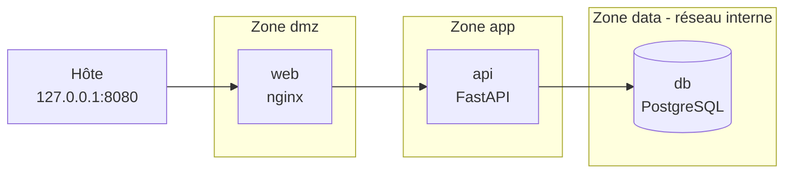

# NeoBank Lab

Projet personnel : construire, sécuriser puis attaquer une mini-banque fictive, sur mon propre ordinateur, pour développer mes compétences en administration réseau, développement sécurisé et pentest, dans la perspective du secteur fintech et bancaire.

> Tout est fictif et tourne en local. Les attaques de la phase 4 visent uniquement ce lab. Les mots de passe présents dans le dépôt sont des valeurs de lab sans valeur.

## Architecture

Quatre services Docker répartis en trois zones réseau isolées. Un conteneur ne peut parler qu'à ceux qui partagent un réseau avec lui : le proxy (zone exposée) ne peut donc jamais joindre la base de données.



| Source | Destination | Autorisé | Raison |
| --- | --- | --- | --- |
| Hôte | web :8080 | Oui | Seul point d'entrée |
| web | api | Oui | Le proxy relaie vers l'application |
| api | db | Oui | L'application lit et écrit les données |
| web | db | Non | La zone exposée ne touche jamais aux données |
| db | Internet | Non | Zone `data` en réseau interne |
| POST | /2fa/setup | Génère un secret TOTP pour l'utilisateur connecté |
| POST | /2fa/enable | Active la 2FA après vérification d'un premier code |

La segmentation est vérifiée automatiquement par `lab-phase1/test_segmentation.py`.

## Avancement

| Étape | Contenu | État |
| --- | --- | --- |
| Phase 0 | Bases réseau (Wireshark), scanner de ports Python, premier lab Docker | Fait |
| Phase 1 | Segmentation en trois zones, tableau des flux, test automatique | Fait |
| Phase 2 | API FastAPI : comptes, connexion JWT, virements atomiques, 9 tests pytest | Fait |
| Phase 2 (suite) | Double authentification TOTP, journal d'audit, limitation de débit, détection de fraude | En cours |
| Phase 3 | Supervision (Wazuh) et règles de détection | À faire |
| Phase 4 | Attaque depuis Kali (OWASP API Top 10), rapport de pentest, correctifs et re-test | À faire |
| Phase 5 | CI/CD avec analyses de sécurité, mapping PCI DSS / PSD2 / DORA | À faire |

## Structure du dépôt

```
scanner.py          Scanner de ports TCP (sockets, bannières, sortie JSON)
lab-phase0/         Premier réseau Docker isolé (web + db)
lab-phase1/         Segmentation en trois zones + test de segmentation
neobank/            API bancaire (FastAPI, PostgreSQL, nginx) et ses tests
```

## Lancer l'API

Prérequis : Docker avec Compose.

```bash
cd neobank
echo "DB_PASSWORD=$(openssl rand -hex 16)" > .env
echo "JWT_SECRET=$(openssl rand -hex 32)" >> .env
docker compose up -d --build
curl http://127.0.0.1:8080/health
```

La documentation interactive de l'API est sur `http://127.0.0.1:8080/docs`. Le fichier `.env` n'est jamais versionné.

La configuration actuelle monte le code dans le conteneur avec `--reload` : c'est un réglage de développement, à retirer avant les tests d'intrusion.

## Tests

```bash
python3 -m venv .venv && source .venv/bin/activate
pip install pytest requests
cd neobank && python -m pytest tests -v
```

Les 9 tests couvrent la validation des entrées, l'authentification, les virements (solde insuffisant, montant négatif, virement vers soi-même) et la double dépense : 8 virements simultanés sur un compte qui n'en permet que 3.

## Choix de sécurité

- Mots de passe hachés avec bcrypt, jamais renvoyés par l'API.
- Requêtes SQL paramétrées contre l'injection ; Pydantic valide les entrées.
- Montants en `Decimal`, jamais en `float`.
- Expéditeur d'un virement tiré du jeton JWT, pas de la requête.
- Virement dans une transaction avec verrou `FOR UPDATE` (ordre fixe des verrous) : pas de double dépense.
- Contrainte SQL `balance >= 0` en dernier rempart.
- Connexion : message d'erreur identique que le compte existe ou non, et hash factice pour égaliser les temps de réponse.
- Jeton JWT de 15 minutes, algorithme imposé au décodage.
- L'API s'exécute sans droits administrateur dans son conteneur.
- Secrets dans `.env`, exclu du dépôt.

## Scanner de ports

```bash
python3 scanner.py 127.0.0.1 -p 22,80,8000-8010 -t 0.5
```

Scan TCP avec lecture de bannière et sortie JSON. À utiliser uniquement sur ses propres machines.

## Journal des problèmes rencontrés

Les pannes rencontrées et leurs causes sont documentées au fil du projet (permissions Docker, clé SSH, indentation Python, résolution DNS de nginx, etc.).

## Licence

MIT